# Отчёт: развёртывание окружения WSL + SDK + PostgreSQL

## 1. Установка WSL и Ubuntu

Установка компонентов WSL через PowerShell. Процесс загрузки и завершение установки.
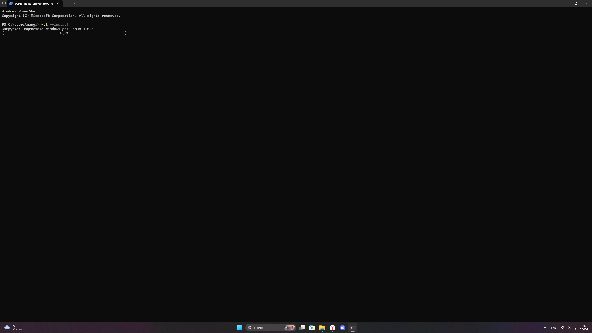
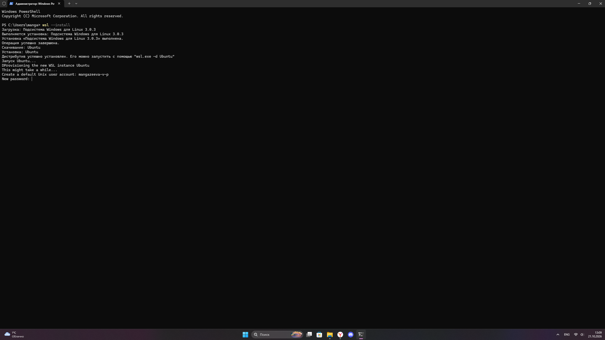

Создание пользователя `mangazeeva-v-p` и установка пароля.
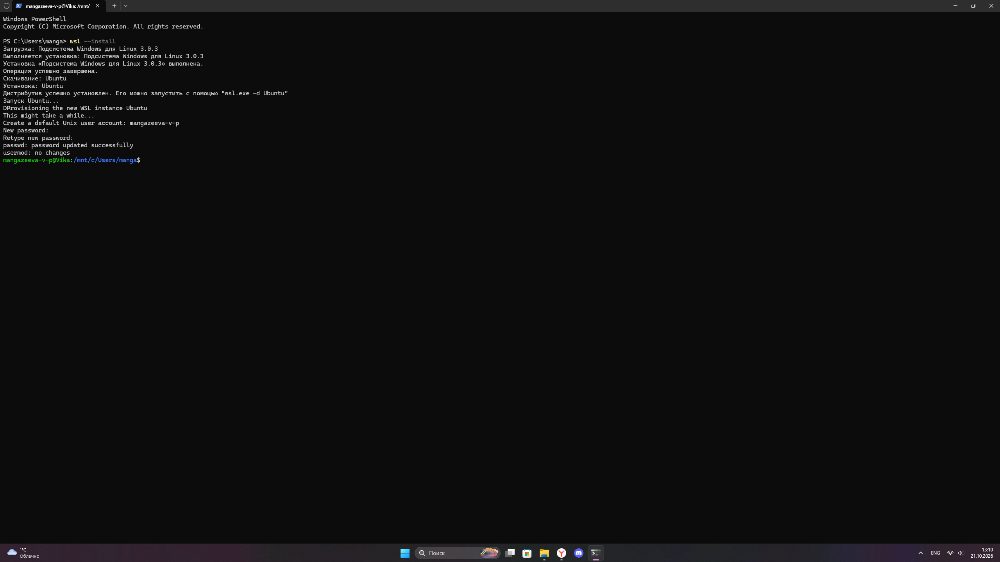

## 2. Первичная настройка и обновление системы

Вход в систему и проверка работы sudo (обновление списка пакетов `sudo apt update`).
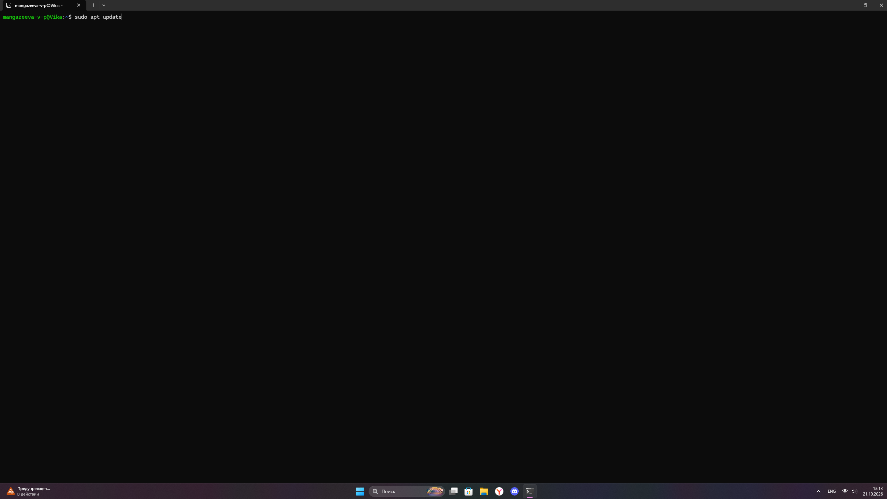
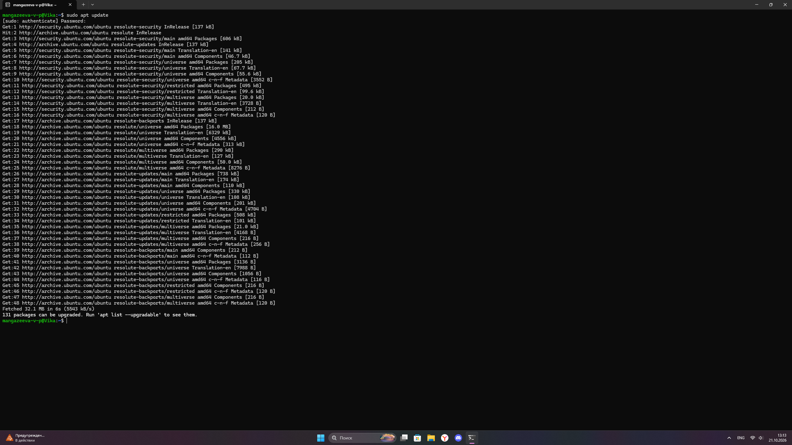

Установка компилятора GCC и базовых утилит (пакет `build-essential`).
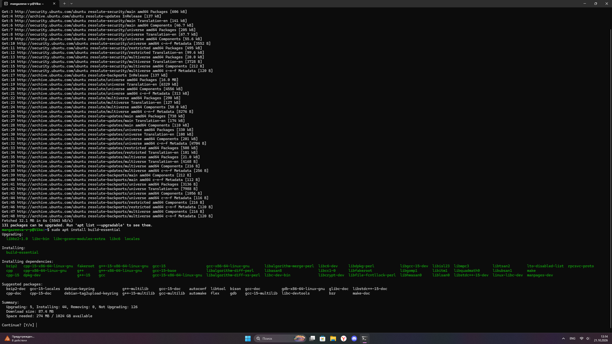
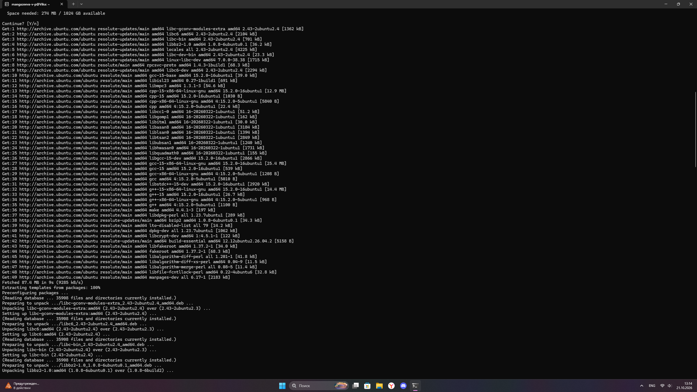
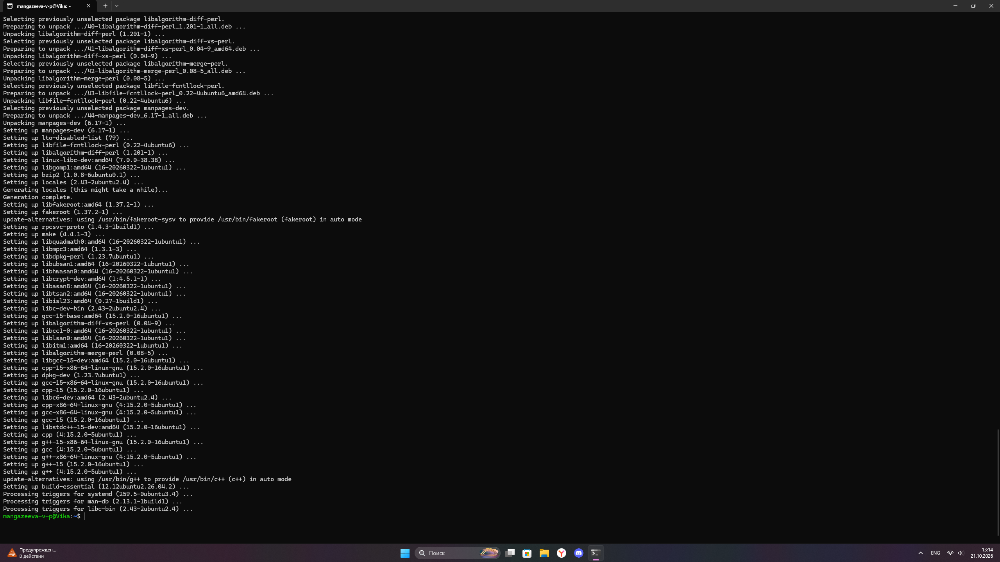

Проверка установленной версии компилятора GCC (15.2.0).
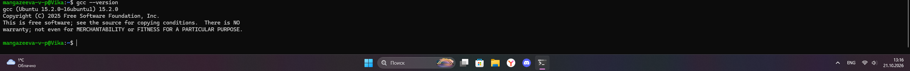

## 3. Установка СУБД PostgreSQL

Установка PostgreSQL (команда `sudo apt install postgresql`).
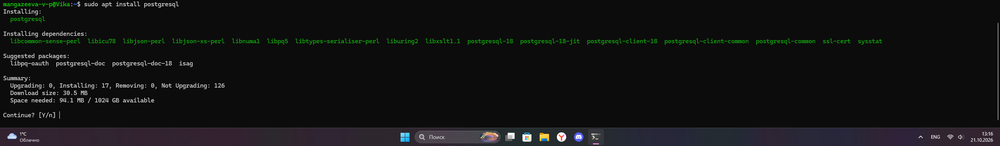
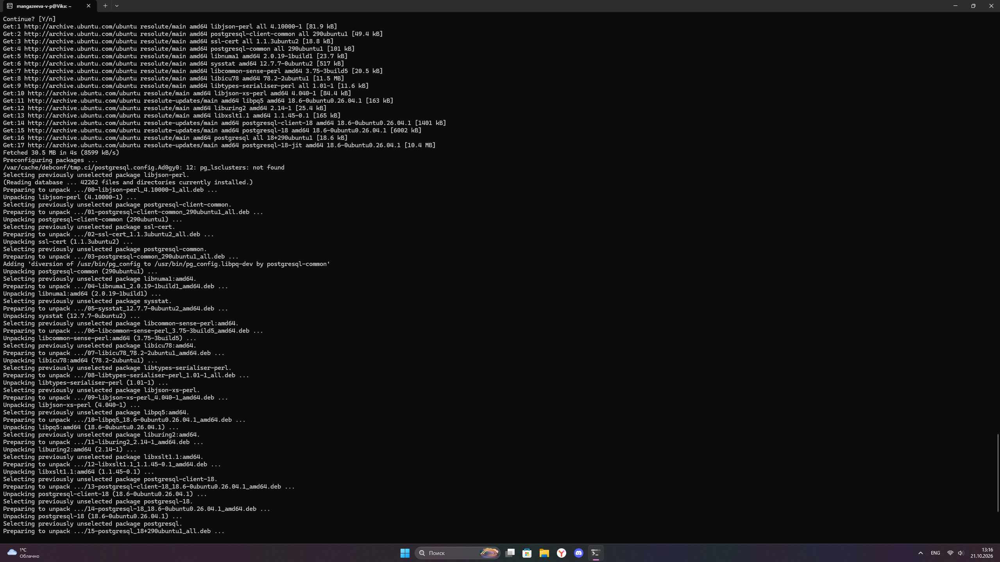

Проверка статуса службы PostgreSQL. Статус `active (exited)` является нормальным для обертки сервиса, так как основные процессы запускаются отдельно.
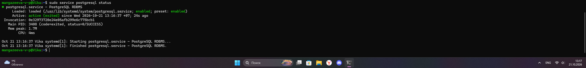

Проверка текущей даты в системе (команда `date`).
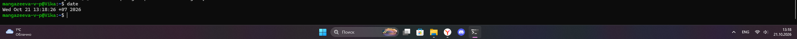

## 4. Установка дополнительных утилит и Python (SDK)

Установка утилит `curl`, `wget`, `git`, `nano`, `unzip`.
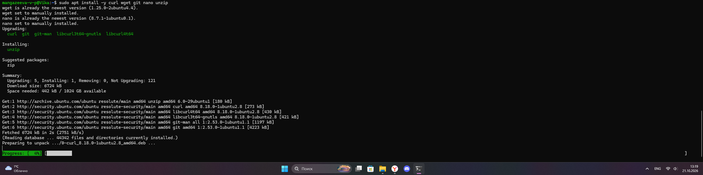

Установка Python 3, pip и venv.
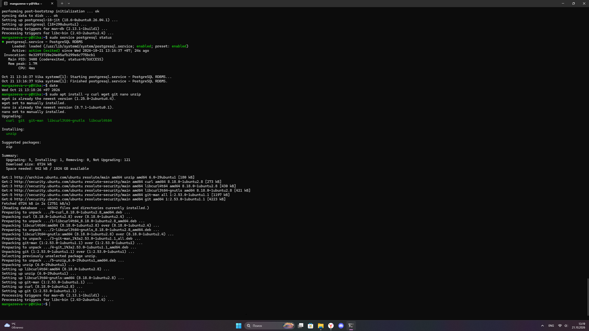
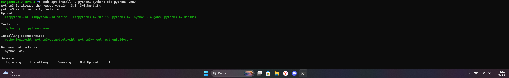

Проверка версий Python (3.14.4) и pip (25.1.1).
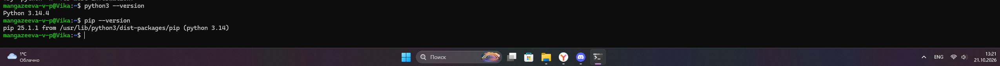

Проверка версии PostgreSQL в командной строке (18.6).
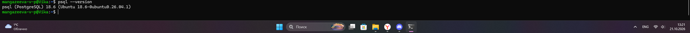

## 5. Создание БД и проверка подключения

Создание пользователя БД `myuser` и базы данных `testdb`.
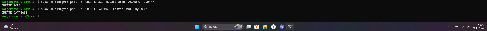

Вывод списка баз данных (команда `\l`) — база `testdb` успешно создана.
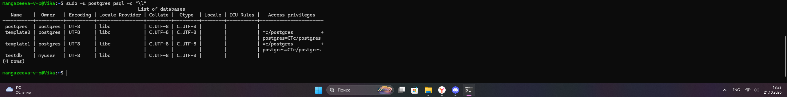

Подключение к базе `testdb` от имени пользователя `myuser` и проверка версии (`SELECT version();`).
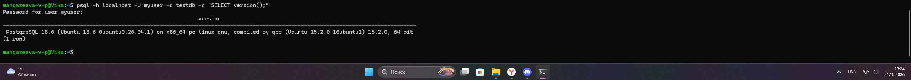

## 6. Подготовка отчета

Создание рабочей директории `wsl-pg-report` и папки для скриншотов `screens`.
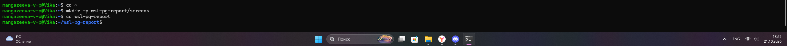

Проверка версии операционной системы Ubuntu (26.04.1 LTS).
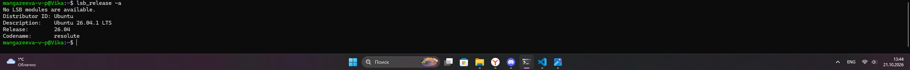
